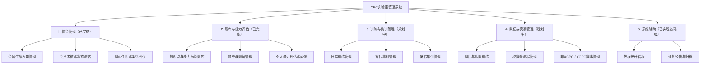
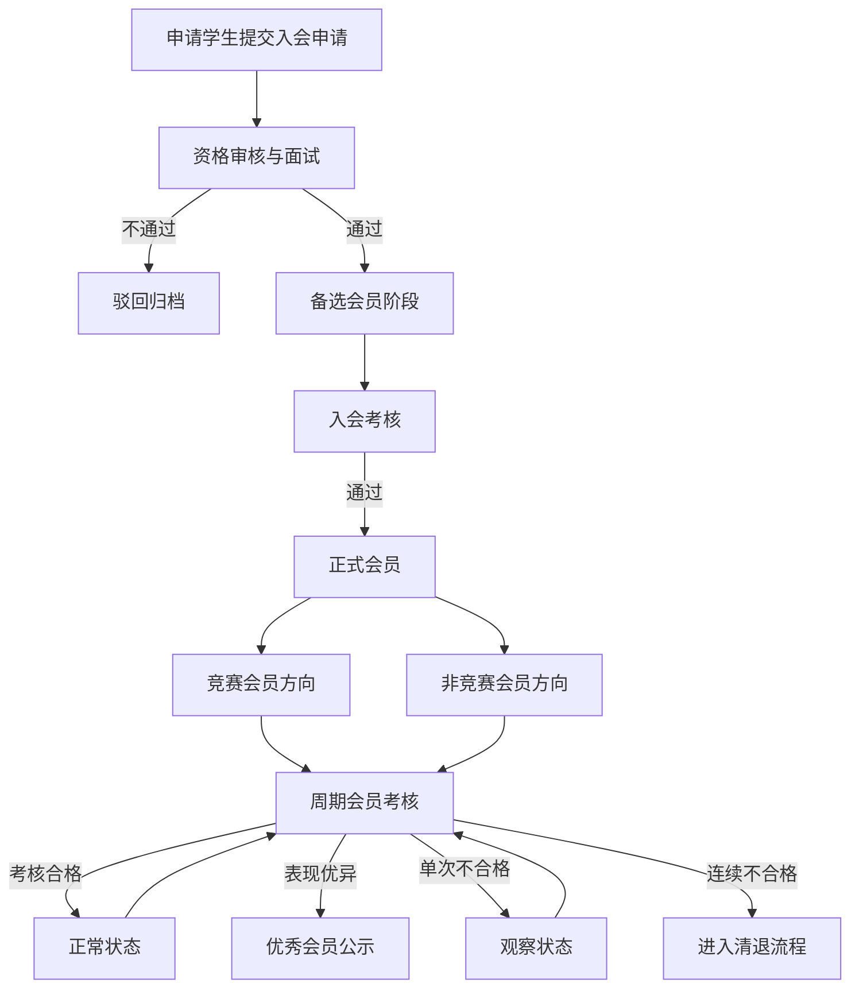
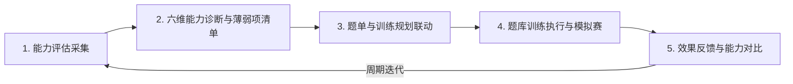

# ICPC 实验室管理系统 — 需求分析文档（规范版）

| 项目属性 | 内容 |
| :--- | :--- |
| 院系 / 专业 / 年级 | 计算机学院 / 软件工程 / 2024级 |
| 项目名称 | ICPC实验室管理系统 |
| 课程名称 | UML与软件工程建模 |
| 指导教师 | 刘卫平 |
| 小组名称 | Kcat |
| 组长及组员 | 李靖宇（202421091067，需求分析、文档编写）、尚思彤（202421091189，流程图绘制）、莫姝（202421091198，文档封面制作）、覃爽爽（202421091165，文档格式整理） |
| 版本 / 日期 | v1.0（2026年9月29日） |

---

## 一、引言

### 1.1 编写目的
本文档用于明确 ICPC 实验室管理系统的业务范围、参与对象、核心流程、功能需求、数据需求和非功能需求，作为 SDD（规范驱动开发）的顶层输入，为原型设计、详细设计、开发实现、测试验收及后续维护提供统一依据。

### 1.2 项目背景
ICPC 协会同时承担算法竞赛人才培养、日常训练组织、校内竞赛组织、校外赛事报名、集训管理以及协会日常事务。传统管理方式依赖聊天工具、电子表格与人工统计，存在信息分散、连续性弱、个体能力差异难以精准跟踪的问题。系统通过**个人能力画像与训练闭环**，将评估结果、训练计划、训练任务、阶段测评与竞赛结果沉淀为连续档案。

### 1.3 系统建设目标
1. 形成统一的会员生命周期与组织任职档案；
2. 建立可维护的知识点题库、实现能力标签与专题题单体系；
3. 建立独立于会员考核的个人能力评估机制与薄弱项识别闭环；
4. 支持日常训练、寒假集训与暑假集训全过程管理；
5. 支持组队、校赛、非 XCPC 比赛和 XCPC 比赛全流程组织；
6. 提供统计看板、通知公告与历史记录归档支撑。

### 1.4 术语说明
| 术语 | 说明 |
| :--- | :--- |
| 备选会员 | 竞赛类申请者通过资格审核后进入的考核阶段，通过入会考核后成为正式会员。 |
| 正式会员 | 完成入会流程并取得协会正式会员资格的成员。 |
| 竞赛会员 | 以算法训练、组队和程序设计竞赛为主要发展方向的正式会员。 |
| 非竞赛会员 | 以协会及实验室日常管理、活动组织和行政事务为主要职责方向的正式会员。 |
| 观察状态 | 正式会员在周期考核不合格后进入的管理状态。 |
| 会员考核 | 用于评价会员阶段表现并支持会员状态、评优与清退等管理事项的综合考核。 |
| 个人能力评估 | 面向竞赛会员的多维能力画像过程，用于识别薄弱项并指导后续训练安排。 |
| XCPC | 统称 ICPC、CCPC 等大学生程序设计竞赛体系。 |

---

## 二、总体需求

### 2.1 系统功能结构

### 2.2 主要参与者
| 参与者 | 主要业务职责 |
| :--- | :--- |
| 申请学生 | 提交入会信息，参加资格审核、面试和入会考核。 |
| 备选会员 | 参加入会考核与基础培养，完成正式入会前流转。 |
| 竞赛会员 | 参加能力评估、日常训练、集训、组队和各类竞赛。 |
| 非竞赛会员 | 承担协会及实验室日常管理、活动组织、行政事务等工作。 |
| 协会工作人员 | 处理会员、组织、题库、评估、训练、竞赛、通知和统计管理业务。 |
| 队长 | 参与队伍训练安排、队员沟通和队伍信息维护。 |

### 2.3 业务状态边界
- **会员资格阶段**（备选会员 / 正式会员 / 已退出）与**会员职责方向**（竞赛会员 / 非竞赛会员）分开记录。
- **观察状态**描述正式会员的周期考核管理状态，不替代备选会员阶段。
- **组织职务**（会长、副会长、部长、副部长、干事等）与会员方向独立记录，不作为会员类别。

---

## 三、核心功能需求清单

### 3.1 协会管理（当前迭代已完成 ✅）

| 编号 | 功能名称 | 功能描述 | 阶段状态 |
| :--- | :--- | :--- | :---: |
| FR-AM-001 | 入会申请管理 | 接收入会申请，记录个人基本信息及学习、竞赛经历。 | ✅ 已实现 |
| FR-AM-002 | 资格审核与面试 | 记录资格审核、面试安排及处理结果。 | ✅ 已实现 |
| FR-AM-003 | 备选会员管理 | 维护备选会员名单、入会考核状态及转正结果。 | ✅ 已实现 |
| FR-AM-004 | 会员信息管理 | 维护会员基本信息、会员阶段、方向、部门和状态。 | ✅ 已实现 |
| FR-AM-005 | 竞赛会员考核 | 记录训练、测评、比赛等表现并形成会员考核结果。 | ✅ 已实现 |
| FR-AM-006 | 非竞赛会员考核 | 记录工作、值班、质量和协作等表现并形成考核结果。 | ✅ 已实现 |
| FR-AM-007 | 观察与清退管理 | 记录观察状态、连续不合格处理和清退/退会过程。 | ✅ 已实现 |
| FR-AM-008 | 奖惩与评优管理 | 维护优秀会员、奖励、警告、通报等记录及公示事项。 | ✅ 已实现 |
| FR-AM-009 | 组织与任职管理 | 维护部门、职务、任期和历史任职信息。 | ✅ 已实现 |
| FR-AM-010 | 会员档案 | 汇总会员考核、任职、奖惩、评估与状态历史。 | ✅ 已实现 |

### 3.2 题库与个人能力评估（当前迭代已完成 ✅）

| 编号 | 功能名称 | 功能描述 | 阶段状态 |
| :--- | :--- | :--- | :---: |
| FR-QB-001 | 知识点与标签管理 | 维护算法知识点、实现能力标签及其说明。 | ✅ 已实现 |
| FR-QB-002 | 题目管理 | 维护题面、样例、来源、链接、难度、知识点和状态。 | ✅ 已实现 |
| FR-QB-003 | 题目检索 | 支持关键词、多知识点（交集/并集）、难度和来源组合筛选。 | ✅ 已实现 |
| FR-QB-004 | 难度管理 | 维护题目的综合难度等级及外部难度信息。 | ✅ 已实现 |
| FR-QB-005 | 题解管理 | 维护题解、解题思路、参考代码和补题材料。 | ✅ 已实现 |
| FR-QB-006 | 题单管理 | 按专题、阶段和补强目标组织训练题目并排序。 | ✅ 已实现 |
| FR-QB-007 | 题库统计 | 统计知识点覆盖、难度分布、来源分布和引用情况。 | ✅ 已实现 |
| FR-AB-001 | 评估任务管理 | 创建个人能力评估并指定竞赛会员与评估周期。 | ✅ 已实现 |
| FR-AB-002 | 能力维度评估 | 记录语言基础、基础算法、模拟逻辑、边界处理、知识点组合、代码调试6维表现。 | ✅ 已实现 |
| FR-AB-003 | 能力画像 | 汇总评估结果，以雷达图与维度卡片展示当前水平。 | ✅ 已实现 |
| FR-AB-004 | 薄弱项识别 | 自动生成薄弱项清单并关联题库推荐补强题单。 | ✅ 已实现 |
| FR-AB-005 | 评估历史 | 保存历次评估记录，支持训练前后对比分析。 | ✅ 已实现 |

### 3.3 后续迭代规划模块（Sprint 3 ~ Sprint 4 🚧）
- **训练与集训管理**：`FR-TRN-001..006`（日常训练计划、任务下发、考勤、效果评估）、`FR-WIN-001..003`（寒假集训）、`FR-SUM-001..003`（暑假集训与多校训练）。
- **队伍与竞赛管理**：`FR-TEAM-001..005`（候选组队、能力互补分析、队伍档案与调整）、`FR-CMP-001..008`（校赛全流程与线上初赛异常核查）、`FR-NC-001..002`（非XCPC赛事）、`FR-XCPC-001..004`（网络预选赛、队伍排序与正赛管理）。
- **系统辅助**：`FR-SYS-001`（数据统计 ✅）、`FR-SYS-002`（通知公告 ✅）、`FR-SYS-003`（历史记录查询 ✅）。

---

## 四、核心业务规则（BR-001 ~ BR-010）
| 编号 | 业务规则 |
| :--- | :--- |
| BR-001 | 竞赛类申请者通过资格审核后进入备选会员阶段，通过入会考核后成为正式会员。 |
| BR-002 | 正式会员按职责方向区分为竞赛会员和非竞赛会员，两类会员采用不同的考核内容。 |
| BR-003 | 正式会员周期考核不合格时进入观察状态，连续考核不合格时进入清退流程。 |
| BR-004 | 竞赛成绩与获奖情况属于竞赛会员综合考核的重要表现材料。 |
| BR-005 | 个人能力评估独立于会员考核，评估结果用于确定竞赛会员的训练补强方向。 |
| BR-006 | 一道题可以关联多个知识点或能力标签，题目综合难度与知识点分别维护。 |
| BR-007 | 个人训练规划应以个人能力评估结果和阶段训练目标为主要输入。 |
| BR-008 | 暑假集训、多校训练、网络预选赛和正赛结果应关联到队伍档案。 |
| BR-009 | 校赛决赛前需完成晋级选手参赛确认，无法参加的选手进入候补处理流程。 |
| BR-010 | 线上校赛的异常行为由系统记录核查材料，最终处理由赛事组织人员完成。 |
