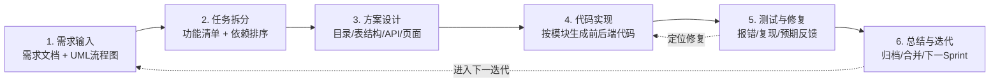

# SDD 规范驱动开发与 AI 辅助协作流程文档

> 对应演讲稿：**第一部分（开发模式与开发范式）、第二部分（小组分工与协作）、第三部分（AI辅助开发流程）**

---

## 一、开发模式与开发范式：Scrum + SDD

### 1.1 为什么采用 Scrum 敏捷迭代
ICPC 实验室管理系统业务链条长（覆盖 5 大域、40+ 功能需求），如果采用瀑布式一次性开发，集成风险高且难以在中期展示阶段性成果。我们采用 **Scrum 敏捷迭代**，将系统拆分为 4 个清晰 Sprint：
- **Sprint 0（10%）**：完成需求分析文档、UML 流程图、数据库与 API 规范设计（SDD 建基）。
- **Sprint 1（20%）**：完成协会管理模块前后端开发与状态机验收。
- **Sprint 2（20%）**：完成题库管理（多对多标签检索）、个人能力评估（六维画像）与首页数据统计看板。**（当前里程碑：50%）**
- **Sprint 3（25%）**：日常训练闭环与寒/暑假集训管理。
- **Sprint 4（25%）**：智能辅助组队、校赛组织与 XCPC 赛事管理。

### 1.2 什么是 SDD（Spec-Driven Development，规范驱动开发）
在 AI 辅助编程中，最常见的问题是「直接丢一句话让 AI 写整个系统」，结果往往出现：
- 业务状态概念混淆（如把备选会员和观察状态混为一谈，或把职务当成会员类型）；
- 数据库字段与前端页面字段名不一致，联调成本高；
- AI 自由发挥导致需求偏离或遗漏关键业务规则（如连续考核不合格自动进入清退流程）。

**我们的 SDD 解决方案**：坚持 **「规范先行、契约驱动、人类把关、AI 落地」**：
1. **先写规范再写代码**：所有模块开发前，必须先确定需求文档（`docs/01`）、规则红线（`.spec/rules.spec.md`）、数据库表结构（`docs/04`）和 API 契约（`.spec/api.spec.yaml`）。
2. **以规范作为 AI 上下文**：每次向 AI 派发任务时，显式绑定对应的 `FR-*` 需求编号、`BR-*` 业务规则和接口契约。
3. **以规范作为验收标准**：生成的代码必须通过对照 `BR-*` 编写的自动化测试用例（`pytest`）与人工 Review。

---

## 二、小组分工与协同机制（Kcat 小组）

为了避免多人使用 AI 生成代码时出现「各自为政、接口对不上、代码风格割裂」，我们将团队工作划分为四个职责域，并以 `.spec/` 作为共享契约中心：

| 职责模块 | 主要负责人 | 核心产出与把关点 |
| :--- | :--- | :--- |
| 需求与架构设计 | 李靖宇（组长） | 维护需求分析文档、SDD 规范（`.spec/*`）、数据库模型与接口契约 |
| 前端开发 | 尚思彤 | 基于 Vue 3 + Vite 实现各模块交互页面、能力雷达图与表单校验 |
| 后端开发 | 莫 姝 | 基于 FastAPI + SQLite 实现业务接口、状态流转逻辑与种子数据 |
| 功能测试与文档维护 | 覃爽爽 | 编写 pytest 自动化测试、核对需求追踪矩阵、维护 Git 分支与文档 |

**协同对齐机制**：
- **迭代前对齐**：每个 Sprint 开始前确定 `FR` 范围，冻结本迭代的 Schema 字段名与 REST API 路径。
- **每日轻同步**：同步阻塞点、接口变更与 AI 生成代码时的异常处理经验。
- **合并前检查**：合并到 `develop` 前必须通过接口契约核对与自动化测试。

---

## 三、AI 辅助开发六步标准流程



### 第一步：需求输入（Context Grounding）
- **做法**：将 `docs/01-需求分析文档.md`、UML 业务流程图（会员生命周期、能力评估闭环）和 `.spec/rules.spec.md` 作为上下文提供给 AI。
- **人工把关**：确认 AI 准确理解「备选会员 vs 观察状态」「会员考核 vs 个人能力评估」「知识点 vs 难度」三大边界。

### 第二步：任务拆分（Task Decomposition）
- **做法**：让 AI 依据需求梳理 `FR` 功能清单，分析实体依赖（例如：先建会员与标签基础表，再建考核/题库关联，最后建能力评估与雷达图），生成本迭代的任务清单。
- **人工把关**：剔除超纲功能，按小组 4 人分工分配独立可并行任务。

### 第三步：方案设计（Spec & Design Freeze）
- **做法**：AI 辅助输出项目目录结构、SQLite 表结构 SQL/ORM 模型、FastAPI OpenAPI 接口契约和 Vue 3 页面原型结构。
- **人工把关**：小组成员逐项审核字段命名、外键约束和状态机流转规则，审核通过后冻结进 `docs/03~06` 与 `.spec/`。

### 第四步：代码实现（Modular Implementation）
- **做法**：严格按模块、按层生成代码：
  1. 后端先写 `models.py` → `schemas.py` → `routers/*.py` → `seed.py`；
  2. 前端先写统一请求封装 `api/index.js` → 公共图表组件 → 各功能视图。
- **人工把关**：拒绝一次性黑盒生成，单次 Prompt 只聚焦 1 个模块或 1 组关联接口，确保可读、可审计。

### 第五步：测试与修复（Verification & Structured Feedback）
- **做法**：运行 `pytest` 自动化测试与浏览器实测。发现 Bug 时，使用**结构化缺陷反馈模板**投喂给 AI：
  ```text
  【所属模块与需求编号】：题库检索 (FR-QB-003 / BR-006)
  【复现步骤】：选择标签「动态规划」与「边界处理」，切换匹配模式为「交集(AND)」
  【实际结果】：返回了仅包含其中一个标签的题目
  【预期结果】：仅返回同时关联两个标签的题目
  【报错/日志】：(粘贴后端堆栈或接口返回 JSON)
  ```
- **人工把关**：修复后必须补充对应回归测试用例，防止后续迭代反复出错。

### 第六步：总结与迭代（Retrospective & Release）
- **做法**：核对本阶段代码是否全部满足 SDD 规则，更新 `docs/08-迭代任务拆分与测试验收报告.md`，完成 `feature/* → develop → main` 合并与版本标签归档。

---

## 四、人机职责边界总结

| 维度 | 人类团队（Kcat）负责 | AI 负责 |
| :--- | :--- | :--- |
| 目标与边界 | 定义业务目标、状态边界与验收标准 | 解析需求文档、梳理依赖与遗漏点 |
| 规范与设计 | 审核冻结数据模型、API 契约与技术栈 | 起草规范文档、表结构与样板架构 |
| 编码与调试 | 审查核心业务逻辑、执行集成验证与 Git 合并 | 按模块生成前后端代码、编写单测与排查报错 |
| 质量与决策 | 决定是否合入主干、评估架构演进方向 | 辅助生成测试用例、整理文档与重构建议 |
