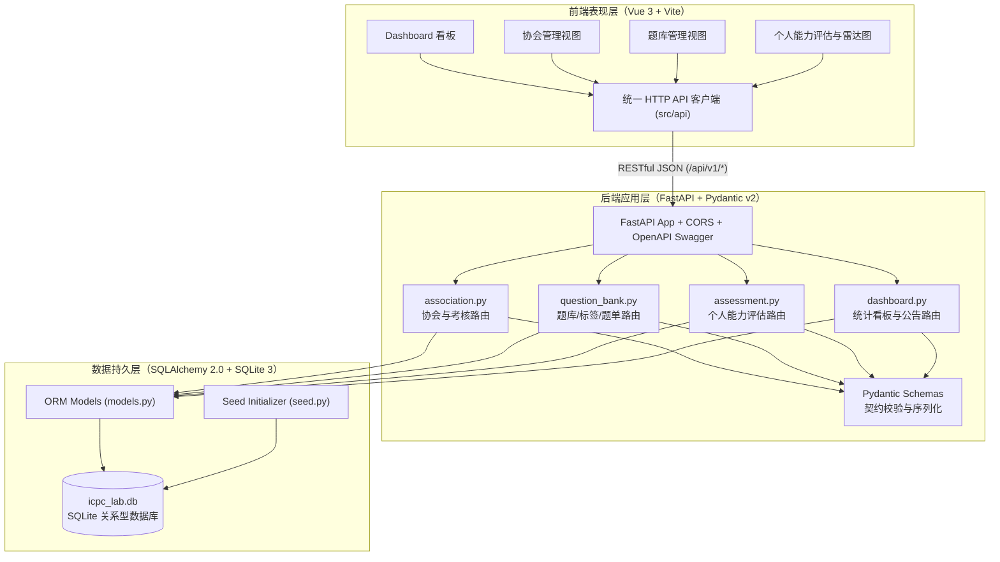
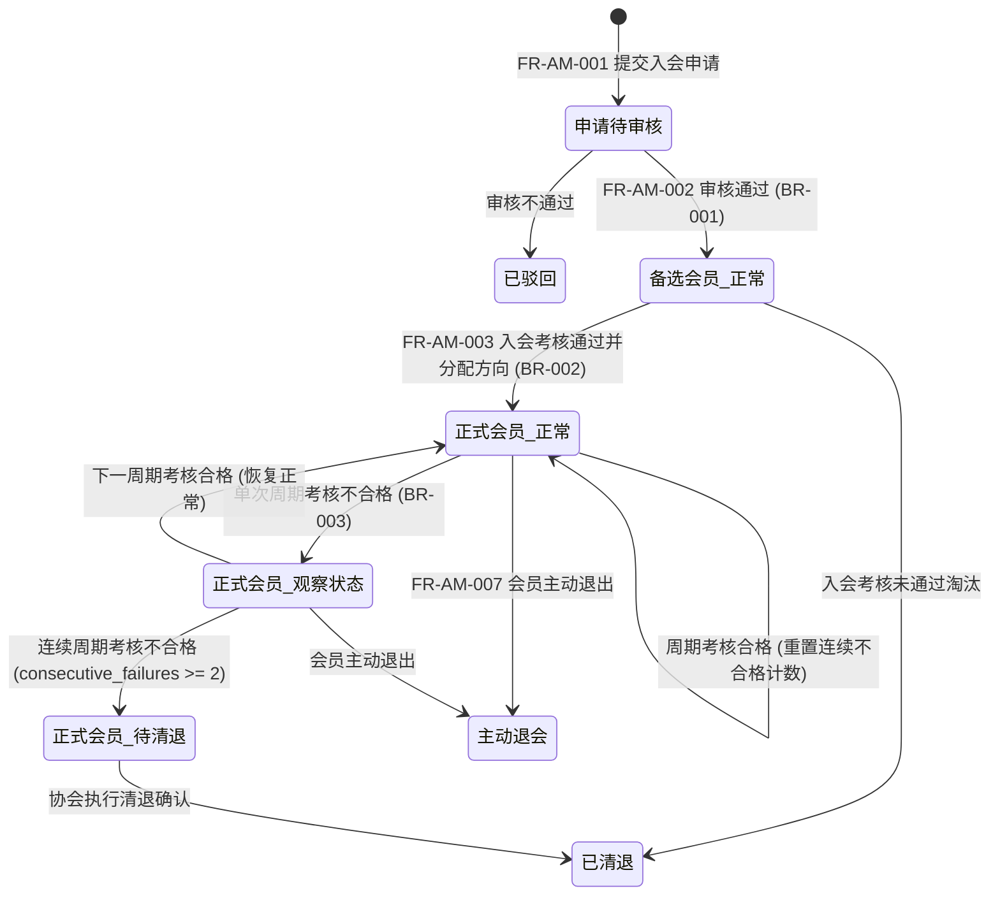

# 系统架构与详细设计文档

## 一、总体技术架构

系统采用经典的前后端分离三层架构，兼顾开发效率、类型安全与本地演示的零部署成本：



### 技术选型依据
| 层级 | 技术选型 | 选型理由 |
| :--- | :--- | :--- |
| 前端框架 | Vue 3 + Vite + Vue Router 4 | 响应式语法简洁，热更新极快，组合式 API 便于按业务模块拆分 |
| 可视化 | 原生 SVG 雷达图 + 统计条形图 | 零外部图表库兼容风险，交互清晰，适配能力画像双周期叠加对比 |
| 后端框架 | FastAPI (Python) | 强类型提示，自动生成 `/docs` Swagger 交互式接口文档，天然契合 SDD 接口规范 |
| 数据校验 | Pydantic v2 | 与 FastAPI 深度集成，自动校验请求参数与业务枚举值，减少非法数据入库 |
| ORM 与数据库 | SQLAlchemy 2.0 + SQLite 3 | 完整支持关系型外键、多对多中间表和事务一致性，单文件数据库开箱即跑 |
| 自动化测试 | pytest + FastAPI TestClient | 支持独立临时库测试，一键验证全部业务规则（BR-001 ~ BR-007） |

---

## 二、核心模块详细设计

### 2.1 协会管理模块（状态机设计）
为严格落实 **BR-001 ~ BR-003**，系统在会员模型上实行「阶段 / 方向 / 状态」三正交字段设计，并由后端服务层统一管控状态迁移：



### 2.2 题库管理模块（多对多标签与组合检索设计）
- **标签双分类**：`tags.category` 分为 `KNOWLEDGE`（算法知识点，如动态规划、图论、数据结构）与 `ABILITY`（实现能力标签，如模拟、逻辑实现、边界处理），解决传统题库难以量化「实现基本功」的痛点。
- **综合难度与标签解耦（BR-006）**：题目 `difficulty` 字段独立存储（`入门 / 普及 / 提高 / 省选 / NOI`），不与知识点耦合。
- **组合检索算法**：
  - `match_mode = "any"`（并集）：`Problem.tags.any(Tag.id.in_(tag_ids))`
  - `match_mode = "all"`（交集）：按所选每个 `tag_id` 动态追加 `EXISTS` / `GROUP BY HAVING COUNT(DISTINCT tag_id) = len(tag_ids)`，精准筛选同时考查多知识点组合的题目。

### 2.3 个人能力评估模块（六维画像与薄弱项闭环）
- **独立性保障（BR-005）**：接口校验仅允许 `direction == "COMPETITION"`（或备选竞赛成员）创建能力评估记录，与会员周期考核表完全隔离。
- **六大评估维度（满分 100）**：
  1. `lang_basic`（编程语言基础）
  2. `basic_algo`（基础算法）
  3. `simulation_logic`（模拟与逻辑实现）
  4. `boundary_handling`（边界处理）
  5. `knowledge_combo`（知识点组合应用）
  6. `coding_debug`（代码实现与调试）
- **自动薄弱项诊断算法**：
  - 凡得分 `< 70` 的维度自动归入 `weak_points`（若全部 ≥ 70，则取最低的 1~2 项作为进阶提升方向）；
  - 系统根据薄弱维度映射到对应的知识点/实现能力标签，自动从题库 `problem_lists` 中匹配推荐补强题单，形成「评估 → 诊断 → 题单补强 → 复评对比」闭环。

---

## 三、后端目录结构规范
```text
backend/
├── app/
│   ├── __init__.py
│   ├── database.py         # SQLite 引擎、SessionLocal、Base 与 get_db 依赖
│   ├── models.py           # 12 张核心业务表的 SQLAlchemy ORM 定义
│   ├── schemas.py          # Pydantic 请求入参与响应出参模型
│   ├── seed.py             # 幂等初始化脚本：预置演示用会员、题库、题单与评估历史
│   ├── main.py             # FastAPI 实例、路由挂载、CORS 与生命周期初始化
│   └── routers/
│       ├── dashboard.py    # 总览统计、里程碑进度、公告
│       ├── association.py  # 申请、会员、转正、考核、奖惩、组织任职
│       ├── question_bank.py# 标签、题目、多条件检索、题解、题单、题库统计
│       └── assessment.py   # 个人能力评估、六维画像、薄弱项推荐与历史对比
└── tests/
    └── test_api.py         # 全模块自动化接口与业务规则测试集
```
