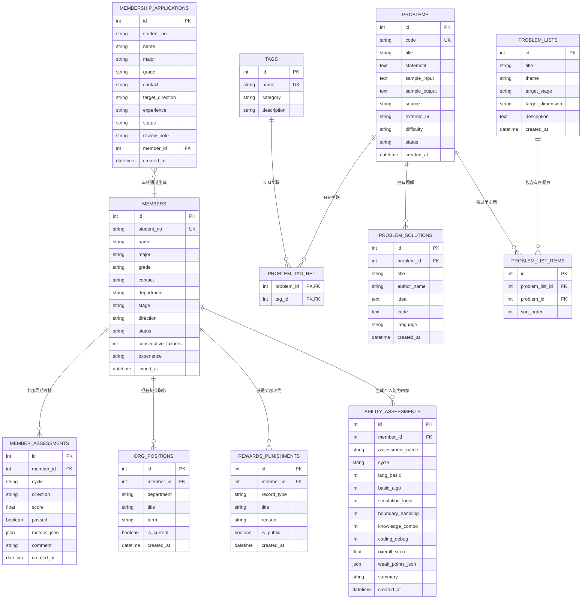

# 数据库设计规范文档（SQLite 3）

## 一、核心实体关系图（ER 图）

---

## 二、核心数据表结构说明

### 2.1 协会管理域（5 张表）
1. **`members`（会员主表）**
   - 唯一索引：`student_no`（学号唯一，防重复建档）。
   - 阶段 `stage`：`CANDIDATE`（备选会员） / `FORMAL`（正式会员） / `EXITED`（已退出）。
   - 方向 `direction`：`COMPETITION`（竞赛会员） / `NON_COMPETITION`（非竞赛会员） / `UNDECIDED`（备选阶段待定或预设）。
   - 状态 `status`：`ACTIVE`（正常） / `OBSERVATION`（观察状态） / `DISMISSAL_PENDING`（待清退） / `DISMISSED`（已清退） / `WITHDRAWN`（主动退会）。
   - `consecutive_failures`：整数计数，支撑 **BR-003** 连续考核不合格自动进入清退流程。

2. **`membership_applications`（入会申请与审核表）**
   - `status`：`PENDING`（待审核） / `APPROVED`（审核通过，已转入备选会员） / `REJECTED`（已驳回）。
   - `member_id`：审核通过后回填生成的 `members.id`，保证全链路追溯。

3. **`member_assessments`（周期会员考核表）**
   - `direction`：与会员方向一致（竞赛 / 非竞赛）。
   - `metrics_json`：结构化 JSON 字段，灵活承载两类不同考核指标：
     - 竞赛会员：`{"training_completion": 90, "attendance": 95, "mock_contest": 85, "contest_awards": "省赛二等奖"}`
     - 非竞赛会员：`{"task_completion": 92, "duty_attendance": 96, "work_quality": 90, "collaboration": 94}`

4. **`org_positions`（组织架构与任职履历表）**
   - 独立存储会员所在部门（技术部、竞赛部、题库组、宣传部、办公室）及职务（会长、副会长、部长、副部长、干事）、任期与是否在任标记 `is_current`。

5. **`rewards_punishments`（奖惩与评优记录表）**
   - `record_type`：`EXCELLENT_MEMBER`（优秀会员） / `EXCELLENT_STAFF`（优秀干事） / `REWARD`（其他奖励） / `WARNING`（警告） / `CRITICISM`（通报批评） / `SUSPENSION`（暂停权限）。

### 2.2 题库管理域（6 张物理表，含 N:M 关联表）
6. **`tags`（知识点与实现能力标签表）**
   - `category`：`KNOWLEDGE`（算法知识点） / `ABILITY`（实现能力标签）。
7. **`problems`（题目主表）**
   - 维护题号 `code`、名称 `title`、题面、样例、来源（校内题库 / Codeforces / AtCoder / 洛谷 / 牛客）、原题链接、综合难度 `difficulty`（入门 / 普及 / 提高 / 省选 / NOI）及题目状态（启用 / 归档）。
8. **`problem_tag_rel`（题目-标签多对多关联表）**
   - 复合主键 `(problem_id, tag_id)`，并设置外键级联删除，实现 **BR-006** 一题多标签灵活关联。
9. **`problem_solutions`（题解与补题材料表）**
   - 关联 `problem_id`，存储解题思路、参考代码、编程语言及作者。
10. **`problem_lists` & `problem_list_items`（题单主表与有序明细表，共 2 张表）**
    - `target_dimension` 字段可与能力评估六大维度关联，支持薄弱项自动推荐补强题单。

*(注：v0.5.0 阶段共 14 张物理表 = 协会管理 5 张 + 题库管理 6 张 + 能力评估与系统辅助 3 张；Sprint 3/4 将全部通过新增表扩展，不修改既有表列定义。)*

### 2.3 个人能力评估与系统辅助域（3 张表）
11. **`ability_assessments`（个人能力评估记录表）**
    - 严格独立于 `member_assessments`（**BR-005**），每次评估新增一条历史记录，永不覆盖旧值，支持时间轴趋势与双周期对比。
12. **`announcements`（通知公告表）**
    - 支持 `FR-SYS-002` 发布训练安排、集训通知、赛事报名与协会事务公告。
13. **`operation_logs`（关键业务操作日志表）**
    - 记录会员状态变更、考核录入、清退处理等审计日志，满足非功能需求 `9.3 安全性` 与 `8.3 数据完整性`。

---

## 三、数据完整性与约束规范
1. **外键约束**：SQLite 连接初始化时强制开启 `PRAGMA foreign_keys=ON`。
2. **唯一性约束**：会员学号 `student_no`、标签名称 `tags.name`、题目编号 `problems.code` 均配置唯一索引，防重复提交。
3. **历史保留原则**：历次考核、历次能力评估、历史任职与操作日志均采用追加写入（Append-Only），确保人才培养全过程可追溯。
