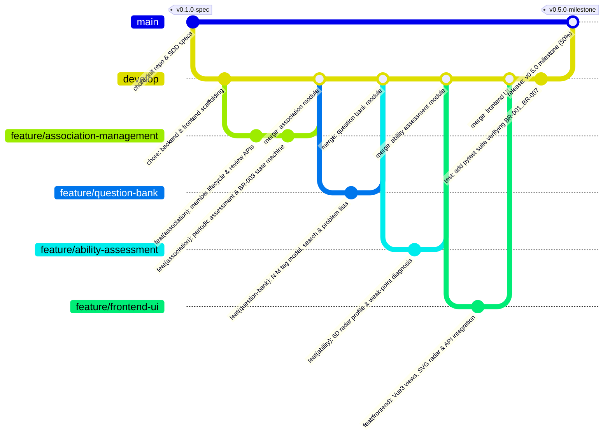

# Git 分支管理与团队协作规范

> 对应演讲稿：**第四部分（版本管理）**

---

## 一、分支模型设计（Git Flow 精简实战版）

我们在 GitHub 协作中采用「主分支 + 开发集成分支 + 功能分支」三级结构，确保多人并行使用 AI 辅助开发时互不干扰、随时可回滚：

### 各分支职责说明
| 分支名 | 生命周期 | 用途与保护规则 |
| :--- | :--- | :--- |
| `main` | 永久 | 存放相对稳定的可演示/可发布版本；禁止直接提交未经测试的代码；每次里程碑合并打 Tag（如 `v0.1.0-spec`、`v0.5.0-milestone`） |
| `develop` | 永久 | 团队集成开发分支，用于汇合各成员完成的功能模块并执行前后端联调与集成测试 |
| `feature/<module>` | 临时 | 功能开发分支（如 `feature/association-management`、`feature/question-bank`、`feature/ability-assessment`、`feature/frontend-ui`），从 `develop` 切出，自测通过后以 `--no-ff` 合并回 `develop` |
| `fix/<issue>` | 临时 | 缺陷修复分支，用于定位并修复测试阶段发现的 Bug |

---

## 二、Conventional Commits 提交规范

每次提交必须遵循 `<type>(<scope>): <subject>` 格式，做到小步高频、语义清晰：

| Type | 含义 | 示例 |
| :--- | :--- | :--- |
| `docs` | 文档与 SDD 规范更新 | `docs(spec): add SDD rules, ER schema and API contract` |
| `feat` | 新增业务功能 | `feat(association): implement periodic assessment state flow (BR-003)` |
| `fix` | 修复缺陷 | `fix(question-bank): fix AND intersection query on multi-tag filter` |
| `test` | 新增或完善自动化测试 | `test(backend): add pytest cases covering BR-001 to BR-007` |
| `refactor` | 代码重构（不改变外部行为） | `refactor(frontend): extract reusable SVG radar chart component` |
| `chore` | 工程脚手架、依赖与脚本配置 | `chore(env): add dev startup script and sqlite gitignore` |

---

## 三、AI 辅助开发下的版本防错与回退策略

在引入 AI 生成代码时，Git 不仅是协作工具，更是**安全网**：
1. **生成前确保工作区干净**：向 AI 下发较大重构任务前先提交当前稳定点，便于 `git diff` 逐行审阅 AI 改动。
2. **按功能原子提交**：每个独立接口或页面验证通过后立刻 `git commit`，避免把 AI 的多轮试错混成一个巨型提交。
3. **快速对比与安全回退**：
   - 审阅 AI 改动：`git diff develop..HEAD`
   - 撤销单次异常生成：`git checkout -- <file>` 或 `git revert <commit-hash>`
   - 查看完整协作演进图：`git log --graph --oneline --decorate --all`
